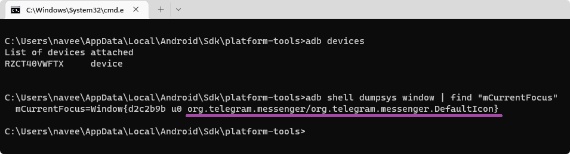

# Lawnicons contributing guide

Welcome to the Lawnicons contributing guide!

In case of unclear wording, ask us in our Discord. If you find errors or want to suggest improvements in the guide itself, create an issue.

[Our Discord](https://discord.com/invite/3x8qNWxgGZ)

## Contributing code

Code-related contributions are welcome. Significant changes to the UI should be discussed in our Discord. Generally, we want to keep things clean and simple.

Visit the Lawnicons developer wiki for developer information regarding Lawnicons.

[Lawnicons developer wiki](https://github.com/LawnchairLauncher/lawnicons/wiki)

## Contributing icons

You can contribute icons, fulfill icon requests, add missing app IDs, refine existing icons, clean up dead apps, and remove duplicates.

1. Create an icon (*.svg) following the design guidelines. [#](https://github.com/LawnchairLauncher/lawnicons/blob/develop/CONTRIBUTING.md#create-icons)
2. Find the app ID to link with your icon. [#](https://github.com/LawnchairLauncher/lawnicons/blob/develop/CONTRIBUTING.md#how-to-find-app-ids)
3. On the Lawnicons repo page, click `Fork`, then clone it locally with GitHub Desktop.
4. Add the icon and the app ID to your local copy and push the changes. [#](https://github.com/LawnchairLauncher/lawnicons/blob/develop/CONTRIBUTING.md#adding-icons-to-lawnicons)
5. Create a pull request and wait for review. [#](https://github.com/LawnchairLauncher/lawnicons/blob/develop/CONTRIBUTING.md#icon-reviews)

[Lawnicons dashboard](https://lawnicons-requests.vercel.app/)

### Create icons

Create icons in a vector graphics editor and save them as SVG. We recommend Figma because it has easier quality control. You can use Advanced SVG Export to save optimized SVGs in Figma.

[Design guidelines](/docs/design_guidelines.md) • [Figma](https://www.figma.com/) • [Advanced SVG Export](https://www.figma.com/community/plugin/782713260363070260)

### How to find app IDs

Every app has a unique app ID, which consists of a package and an activity separated by `/`. App IDs allow you to link icons and apps. 

```
App ID: app.lawnchair.lawnicons/app.lawnchair.lawnicons.MainActivity
Package: app.lawnchair.lawnicons
Activity: app.lawnchair.lawnicons.MainActivity
```

#### Lawnicons

Install and open Lawnicons → Tap `⋮` → Tap `Request icons` → Select icons → Tap `Copy App IDs` in the split button's menu and save it wherever it's convenient.

[Download Lawnicons](https://github.com/LawnchairLauncher/lawnicons#download)

#### Alternatives

[Icon Request](https://play.google.com/store/apps/details?id=de.kaiserdragon.iconrequest) • [Icon Pusher](https://play.google.com/store/apps/details?id=dev.southpaw.iconpusher)

#### Android Debug Bridge (adb)

1. Connect your Android device or emulator to your laptop/desktop PC that has `adb` installed.
2. Open the app whose details you want to inspect (e.g. Telegram).
3. Open a new Command Prompt or Terminal window and input `adb devices`.
4. Finally, type the below-given command to get the information about the currently open app.

[How to install ADB](https://www.xda-developers.com/install-adb-windows-macos-linux/)

  Mac or Linux

  ```console
  adb shell dumpsys window | grep 'mCurrentFocus'
  ```

  Windows

  ```console
  adb shell dumpsys window | findstr "mCurrentFocus"
  ```
  

### Adding icons to Lawnicons

> [!TIP]
> [View on YouTube](https://youtu.be/UXic1zy-CiQ)

You need to link SVGs and app IDs correctly, create a PR to our repository through your fork, and wait for it to be reviewed. Avoid name conflicts and make sure your contributions haven't been made earlier.

Let's imagine that you have an icon in SVG format, an app name and an app ID.

[GitHub Desktop](https://github.com/apps/desktop) • [How to find app IDs](#how-to-find-app-ids)

```
Icon: lawnicons.svg
App name: Lawnicons
App ID: app.lawnchair.lawnicons/app.lawnchair.lawnicons.MainActivity
```

1. Fork the Lawnicons repository. 
2. Clone the fork via GitHub Desktop.
3. Open it with a file explorer. This is your local copy.
4. Сopy `lawnicons.svg` to the `svgs/` folder. Note the icon name.
5. Open `app/assets/appfilter.xml` and add a new line using the same template as the existing lines.
6. Save changes and push it to your fork via GitHub Desktop.
7. Open your fork in a web browser and create a PR: `Contribute → Open pull request`.
8. Make sure that the build went without errors and common issues are fixed, then await review.

### Icon reviews

1. Our review bot runs its checks and gives feedback. If the contributor doesn't fix the icon issues, the PR isn't worth pursuing.
2. If the bot finds no issues, a maintainer does a detailed review — up to 5 icons at a time, depending on how many issues are left.
3. The maintainer merges the PR once all issues are resolved, sometimes fixing them directly to speed things up.

PRs with long-ignored issues are closed automatically.

Reviews serve two goals: keeping icon quality high and filtering out rushed attempts that skip the guidelines. This saves time for everyone involved. To review icons, you should be able to create at least 20 random icons flawlessly in one go. That demonstrates solid knowledge of the design guidelines. Reviews often take longer than making an icon, so fixing a few incorrect ones is faster than explaining the issues.

### Future contributions

Please keep your repository up to date if you plan to create more than one PR, otherwise you may drag the commit history through all your PRs. There are two main ways to do this:
- Open `Terminal` on the local copy of your repository via GitHub Desktop. Run `git reset --hard upstream/develop`. Overwrite your repository with your local copy via GitHub Desktop: `Force push origin`.
- Or delete your repository and start the contribution process from scratch.

If you plan to contribute icons regularly, it's worth learning [icontool.py](/docs/icontool_guide.md).
