# Lawnicons design guidelines

> [!TIP]
> [View in Figma](https://www.figma.com/community/file/1544976260626797886)

Please read these guidelines carefully to avoid rework. The goal is to create high-quality icons that represent their apps, even if it means redesigning from scratch. Prioritize quality over exact reproduction, and make it pixel-perfect.

The contributors who laid the foundations: [GrabsterTV](https://github.com/Grabstertv) and [Chefski](https://github.com/Chefski).

## Naming

### TL;DR
```
_2048.svg | 2048
lawnicons.svg | Lawnicons
habitacao_caixa.svg | Habitação Caixa
beijing_card.svg | 北京一卡通 ~~ Beijing Card
a_and_w.svg | A&amp;W
```

### App name

The app name should be in its primary language, sourced from app stores. For non-English names, add a localized or transliterated English version, separated by `~~` (main name first). If the name is mostly English letters, no second name is needed.

Delete things that aren't part of an app name, and use HTML character references for special symbols (for example, &amp; instead of &).

### Icon name (drawable)

Repeat the app name, using `a–z`, `0–9`, and `_` for spaces. Insert `_` before a digit if the icon name starts with one. For multiple apps sharing one icon, use the most popular name.

## Fundamentals

The best way to learn the design guidelines is to read them through once, then refer back to each point as you work on each icon.

> [!TIP]
> [View on YouTube](https://youtu.be/XO-5IwowonQ)

### 1 Canvas

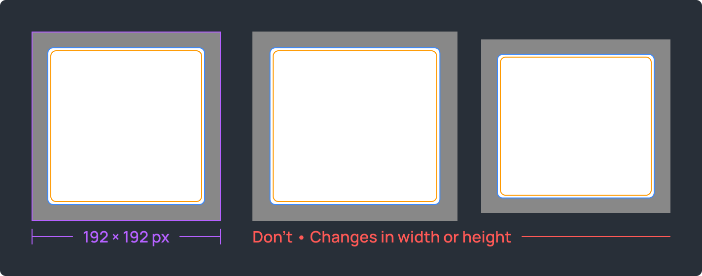

`192 × 192 px`. Use the correct canvas size to create a safe zone around icons.  

### 2 Abstract icons

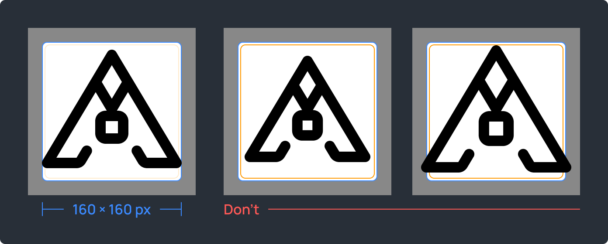

The exact abstract icon size is determined by the stroke's position, weight, and the graphic editor used.  
For a `12 px` center stroke in Figma, the icon content area is `148 × 148 px`.

Tips: follow the blue guides, use existing icons as an example, and aim for pixel-perfect.

### 3 Square icons

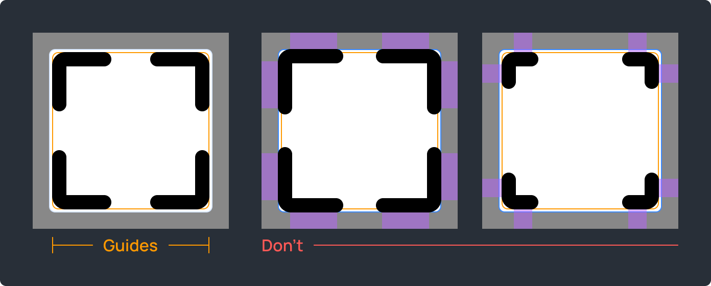

These are icons with `50%` or more of the edges running along the square. The square icon size is determined by the stroke's position, weight, and the graphic editor used. For a `12 px` center stroke in Figma, the square icon content area is `142 × 142 px`.

Tips: follow the golden guides, use existing icons as an example, and aim for pixel-perfect.

### 4 Color

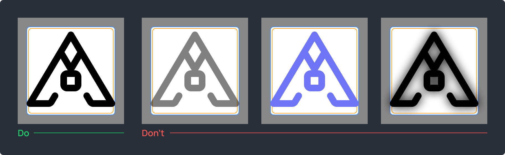

All lines must be non-transparent black color: `#000000`.  

### 5 Stroke weights

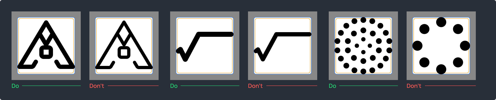

Core stroke weight: `12 px`  
Minimal icons: `14 px`  
Dense icons: `10 px`  
Ellipses, rectangles and fine details: `12 px`, `10 px`, `8 px`, `6 px`  

Exact values only, no fill. Shapes should be outlined.

### 6 Caps and joints

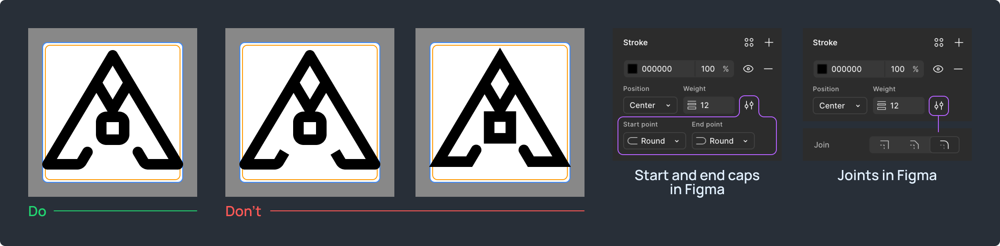

Caps and joints should be rounded.  

### 7 Corner radius

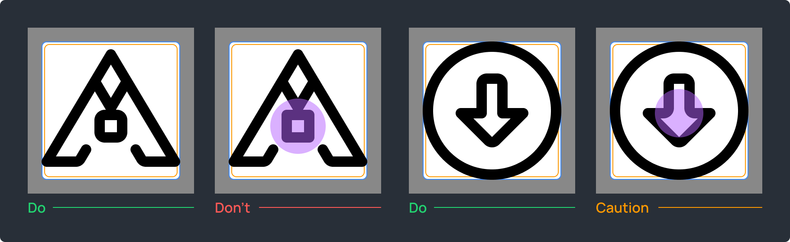

Use no less than `6 px` for `90°` angles. Refer to the original icon to select a value. It's allowed to leave a `0 px` radius in cases when the others spoil the shape: for instance, when `90°` angles are formed of short lines.

## Quality

### 1 Visual balance

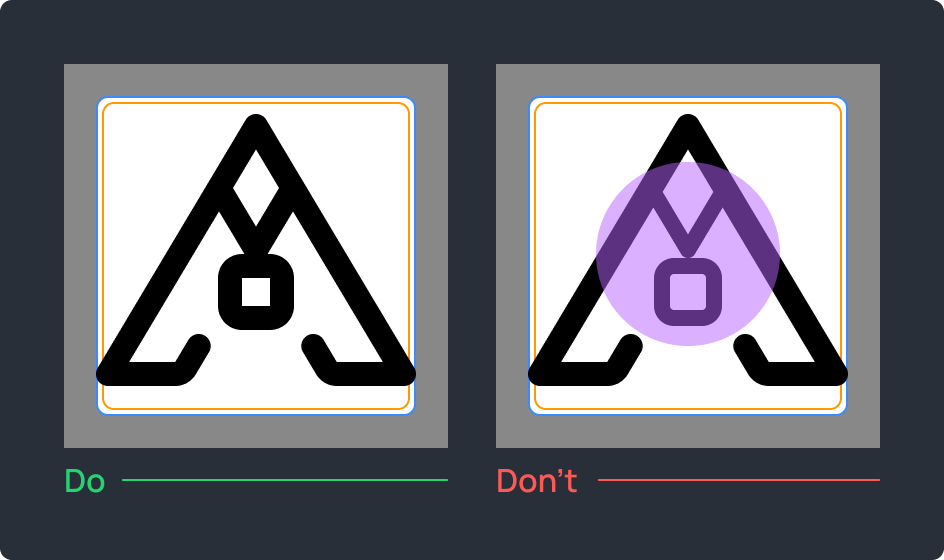

Avoid drastic changes in stroke weights. For instance, using a `12 px` stroke and suddenly decreasing it to `8 px` creates an unbalanced visual effect.

### 2 Black spots

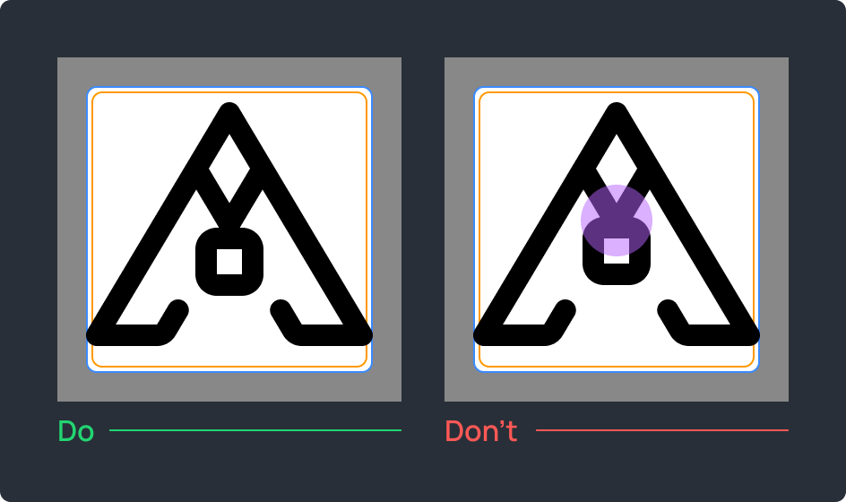

Avoid black spots as much as possible.

### 3 Excessive density

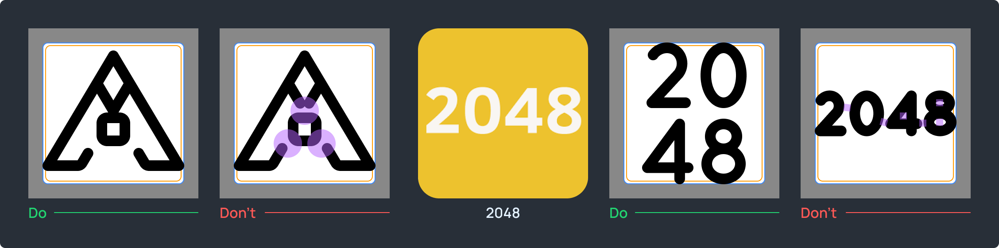

Keep at least `8 px` between lines, using an `8 × 8 px` rectangle to verify the spacing. It’s better to make the distance a little more, especially in closed shapes.

Tips: move lines further apart or combine into one, and enlarge original icons to make the main features easier to draw.

### 4 Alignment

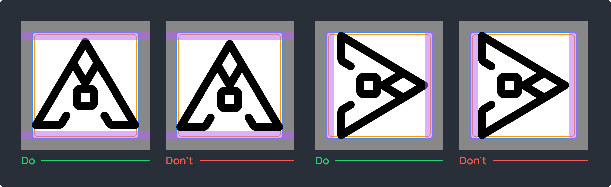

Icons should be centered, but shape-aware. Align them to the optical center as much as possible within the icon content area. The optical aligment is where your icon looks and feels centered.

### 5 Text icons

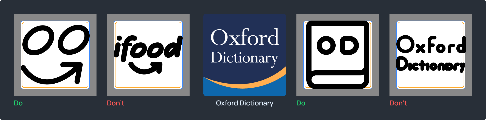

Text longer than `3` letters in `1` line usually doesn’t fit the Lawnicons style. Apps and games with text icons often need to be studied in order to create a recognizable Lawnicons-style icon.

If you want to keep only a text, then it should be of high quality and occupy at least `¹⁄₃` of the icon content area.

### 6 Complex icons

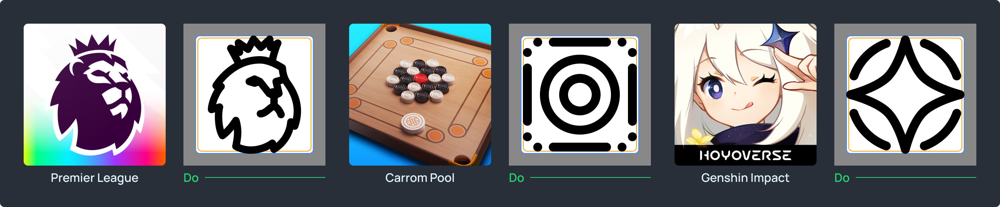

First, try to make a complex icon based on the original. When it’s clear that the original icon can’t be conveyed in the Lawnicons style, you need to study the visual part of an app or a game. Whatever you come to, the result should be at least logical and high-quality.

Recognition sources: branding guidelines, UI or gameplay, website favicons, in-app icons, essence of an app or game, and a combination of recognizable features with your own ideas.

### 7 Version badges

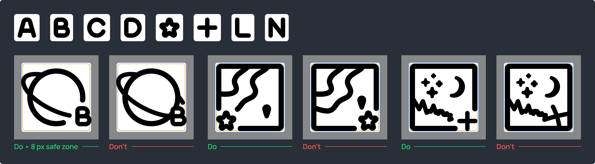

Use one of our version badges to highlight a separate version of an app. For instance, it could be nightly builds or paid apps with a free one available. Keep in mind that cases such as Opera Mini or Firefox Klar are different.

Tips: cut lines around the badge, place it in the lower right corner when possible, and don't shift icons for it.

### 8 Minimal generic icons

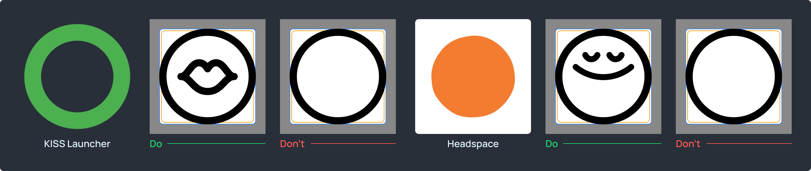

Minimal generic icons need distinctive features to aid recognition.
